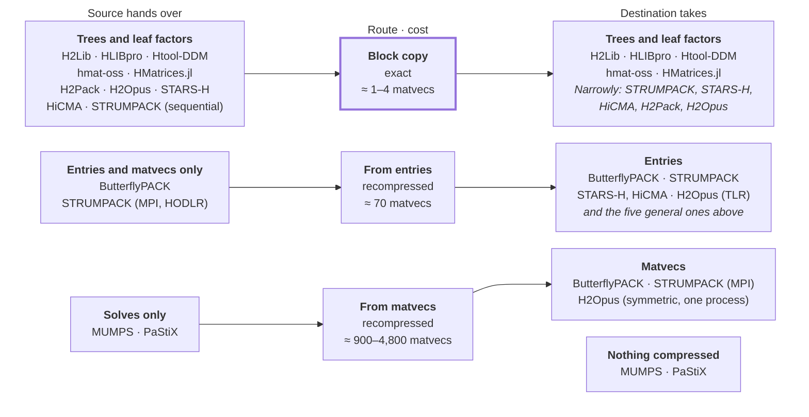

# Moving H-matrices between libraries

> Written in October 2026 by Nick Alger with Claude Opus 5.5. Reflects the library versions listed under [Sources](#sources); later versions may differ. [All background docs](README.md) · [Overview of the twelve packages](overview.md)

Most of the twelve libraries can hand a compressed matrix to some other library, but only one route is cheap. A block copy of the trees and leaf factors cost 1–4 source matvecs in our prototype and lost nothing. Five libraries accept a block copy of a general H-matrix: H2Lib, HLIBpro (C++ only), Htool-DDM, hmat-oss (through its serialization stream) and HMatrices.jl (from Julia). Only Htool-DDM among them runs under MPI, and four more libraries take only narrow special cases.

Every other move rebuilds the matrix in the destination, from entries for about 70 matvecs or from matvecs for 900–4,800. Both cost more than rebuilding from the kernel. Only ButterflyPACK, STRUMPACK and H2Opus can rebuild from matvecs, and MUMPS and PaStiX neither take nor give compressed matrices. No common format or API exists; PETSc's sampling of any operator into H2Opus is the only ready-made bridge.

The glue is short, 25–325 lines in the prototypes, but full of silent traps: orderings, index bases, factor conventions, unchecked tree requirements, and libraries that exit the host program. A four-library chain (construct, convert, compute, multiply) works on one node when every hop is a block copy. A single rebuild hop dominates its cost, and the chain breaks under MPI, because the other general importers are single-node.

## At a glance

*Block copies are cheap but need an importer on the far side. Each row pairs what a source hands over, the route it allows and the destinations that take it; a source can also use any route below its own row. Costs are in source matvecs. (Transfer routes between the twelve libraries · 3 routes, 4 destination groups.)*

The dense round trip, open to nearly every pair, is left out: it moves all N² values.

## Transfer routes

A compressed matrix can move between libraries in four ways, and only the block copy keeps it intact. The other three rebuild it in the destination, recompressing every block; [Measured costs](#measured-costs) gives the numbers.

| Route | What crosses | Copies | Communication under MPI | Duplicated computation | Accuracy |
| --- | --- | --- | --- | --- | --- |
| Block copy | Cluster tree, permutation, block tree and leaf factors | Each stored value once, or none for leaves the destination can borrow | Every leaf moves to wherever the destination keeps it; into a single-node library, the whole matrix is gathered | None, apart from splitting blocks when the destination needs a finer tree | Exact |
| Rebuild from entries | The entries the destination's compressor asks for | Slightly more values than the source stores, each copied once | One request and reply per block row or column; latency-bound when the source is remote | All of the destination's compression, and a dot product of length k for each entry read from a low-rank leaf | The two libraries' errors add |
| Rebuild from matvecs | Blocks of random vectors and their products | 2·N values per sampling vector, 5–20× the source's storage in the prototypes | An all-to-all of every sampled block when the two libraries distribute vectors differently | Everything: hundreds to thousands of source products, then the destination's compression | Can miss the requested tolerance several-fold |
| Dense round trip | The full matrix | N² values | N² values | N matvecs or N² entries, then full compression | As for entries; impractical beyond about N = 10⁵ |

Which route is open depends on both ends: the source must export what the route needs and the destination must accept it (see [What each library exposes](#what-each-library-exposes)).

## Which formats can move

Flat low-rank formats (H, HODLR, BLR, TLR) move losslessly into any library that stores general H-matrices. Nested bases survive only between H2Lib and HLIBpro, and butterfly blocks survive nowhere.

| Source format | Lossless into | Needs recompression into |
| --- | --- | --- |
| H, with dense and low-rank leaves | H in H2Lib, HLIBpro, Htool-DDM, hmat-oss and HMatrices.jl, if each accepts the source's block tree (below) | H², HSS, BLR or TLR anywhere; HODLR in ButterflyPACK or STRUMPACK |
| HODLR, BLR, TLR | The same five, as weakly admissible or one-level H; uniform tiles into STARS-H or HiCMA; sequential BLR into STRUMPACK | H², HSS, butterfly |
| H² and HSS | H² between H2Lib and HLIBpro; into H2Opus only on a tree it would build itself; into H2Pack only if real and symmetric; HSS into STRUMPACK's sequential HSS only in interpolative form, by a workaround; expanded to H in the five H libraries, with storage growing by about the tree depth | Anything needing other bases or another tree |
| Directional H² (H2Lib) | Expanded to H in the five H libraries | Everything else |
| Butterfly (ButterflyPACK, STRUMPACK's HODBF) | Nowhere: no other library stores butterfly blocks, and ButterflyPACK cannot export them through its C interface | Any format, through entries or matvecs |
| BLR inside MUMPS, PaStiX and STRUMPACK's sparse solver | Nowhere: these compress LU factors, not A, and none exports them | Not applicable |

Tree shapes and scalar types decide whether a nominally lossless copy goes through:

- hmat-oss needs each block's children to be every pairing of row and column children.
- Htool-DDM's generator hooks rebuild its own tree shape; its add\_child route takes any tree.
- HMatrices.jl makes a dense leaf whenever either cluster is a leaf, so a low-rank block on a leaf cluster needs a hand-made node.
- H2Lib takes any tree, but its H→H² conversion silently returns a wrong matrix on a non-strict one.
- H2Opus needs a binary median-split tree with all leaves at one depth, one tree for rows and columns, and ranks uniform per level.
- H2Pack needs at most 2^d children per node and admissible pairs on equal levels.
- H2Pack and H2Opus are real only; H2Lib holds one scalar type per build, so real and complex cannot share a process.

## What each library exposes

Most libraries let you read their trees and leaves, fewer let you write them, and only three build from another library's matvec. Marks: ✓ public interface; ◐ partial, internal headers or a short workaround; ✗ absent. Glue lines are the surveys' estimates for exporting to, and importing from, a neutral in-memory form (trees, permutation, leaves).

| Library | Trees and leaves out | Entries out | Matvec out | Trees and leaves in | Built from entries | Built from matvecs | Glue lines out / in |
| --- | --- | --- | --- | --- | --- | --- | --- |
| STRUMPACK | ◐ sequential BLR; HSS through protected members; nothing under MPI or for HODLR | ✓ HSS, BLR; HODLR collective | ✓ except MPI BLR | ◐ sequential BLR; HSS only in interpolative form | ✓ HSS, BLR, HODLR family | ◐ HODLR family, MPI only, needs Aᵀ | 40 / 50 for BLR; ✗ under MPI |
| ButterflyPACK | ✗ Fortran internals only | ✓ collective, permuted indices | ✓ collective | ✗ | ✓ all formats | ✓ HODLR, and H or BLR with low-rank leaves; needs Aᵀ | 300–500 / 600–900, Fortran internals |
| H2Opus | ✓ public members, host memory | ✗ | ✓ permuted order | ◐ only on its own tree | ◐ TLR only | ◐ H², symmetric, one process | 150 / 200 on its own tree |
| HiCMA, STARS-H | ✓ STARS-H; HiCMA as padded copies; HiCMA-PaRSEC internal | ✗ | ◐ STARS-H and TLR-MVM only | ✓ STARS-H; HiCMA uniform tiles | ✓ tile kernel, about N²/2 entries | ✗ | 50–200 / 80–300 |
| Htool-DDM | ✓ C++, zero-copy | ✗ | ✓ also MPI | ✓ through generator hooks | ✓ sub-block callback | ✗ | 80–120 / 100–150 |
| HLIBpro | ✓ C++ only | ◐ single entries | ✓ internal ordering | ✓ C++ only | ✓ C++ and C | ✗ | 150–200 / 150–250 |
| H2Lib | ✓ public structs, H and H² | ✗ | ✓ | ✓ public structs, H and H² | ◐ BEM operators only | ✗ | 80–140 / 120–200 |
| hmat-oss | ✓ through its serialization stream | ✓ 1-based | ✓ | ◐ by writing its stream | ✓ | ✗ | 80–200 / 150–200 |
| HMatrices.jl | ✓ Julia fields | ✗ | ✓ | ◐ hand-built in Julia | ✓ any AbstractMatrix | ✗ | 60–100 / 100–150, in Julia |
| H2Pack | ✓ public struct, stored mode | ✗ | ✓ symmetric | ◐ file only, real symmetric H² | ✗ kernel at points | ✗ | 150–250 / 150–250 |
| MUMPS | ✗ | ◐ entries of A⁻¹, dense Schur | ◐ solves | ✗ sparse input only | ✗ | ✗ | — / ✗ |
| PaStiX | ✗ | ◐ dense Schur, one process | ◐ solves | ✗ sparse input only | ✗ | ✗ | — / ✗ |

Two gaps shape everything else. Libraries without entry access (H2Lib, Htool-DDM, H2Opus, H2Pack, HMatrices.jl) can still serve entries through a 25–150-line walk of their exported leaves. Kernel-at-points builders (H2Opus's H², H2Pack) cannot be fed from another matrix at all, because they evaluate the kernel at points that are not matrix indices.

## Measured costs

In three prototypes, a block copy cost 1.2–3.6 source matvecs and lost nothing. Rebuilding cost 70 matvecs from entries and 900–4,800 from matvecs, each more than the destination's own build from the kernel. All runs used a smooth kernel on points on a sphere, at tolerance 1e-6.

*Three prototype transfers on a 2-core VM, one thread; a source matvec is one single-vector product timed in the same process*

Data behind the figure

| Route | Pair | N | Cost (source matvecs) | Destination's own build from the kernel, same N (source matvecs) |
| --- | --- | --- | --- | --- |
| Block copy, leaves borrowed | Htool-DDM → H2Lib | 4,000 | 1.3 | 16 |
| Block copy, leaves borrowed | Htool-DDM → H2Lib | 20,000 | 1.2 | 12.6 |
| Block copy, leaves copied | Htool-DDM → H2Lib | 4,000 | 3.6 | 16 |
| Block copy, leaves copied | Htool-DDM → H2Lib | 20,000 | 2.3 | 12.6 |
| Rebuild from entries | hmat-oss → Htool-DDM | 5,000 | 70 | 15.4 |
| Rebuild from entries | hmat-oss → Htool-DDM | 20,000 | 71 | 16.4 |
| From matvecs, HODLR | Htool-DDM → ButterflyPACK | 4,000 | 934 | 584 |
| From matvecs, HODLR | Htool-DDM → ButterflyPACK | 16,000 | 1,364 | 812 |
| From matvecs, H | Htool-DDM → ButterflyPACK | 4,000 | 1,514 | 728 |
| From matvecs, H | Htool-DDM → ButterflyPACK | 16,000 | 2,019 | 544 |
| From matvecs, H² | Htool-DDM → H2Opus | 4,000 | 2,910 | 831 |
| From matvecs, H² | Htool-DDM → H2Opus | 16,000 | 4,782 | 498 |

| Transfer | Error vs source | Notes |
| --- | --- | --- |
| Block copy, Htool-DDM → H2Lib | 1.0–1.4e-15 | Borrowing aliases dense blocks and U; only V is copied, 30–40% of the values |
| Then H → H² inside H2Lib | 4.2–5.4e-7 | 64–74 source matvecs, 3.4–4.5× the source's own build; correct only on a strict block tree |
| Rebuild from entries, hmat-oss → Htool-DDM | 1.3–1.5e-6 | 1.26–1.33× the source's stored values extracted; thread-safe; the source must use full storage |
| From matvecs, ButterflyPACK HODLR | 4.1–7.4e-6 | 4,068–8,122 sampling vectors; a third of the calls asked for Aᵀ |
| From matvecs, ButterflyPACK H | 1.1–3.2e-6 at tolerance 1e-7 | At 1e-6 the error was 6–7e-6; matvecs need ErrSol = 1 to keep a forward operator |
| From matvecs, H2Opus H² | 2.0–4.6e-6 | 2,062–4,174 sampling vectors; H2Opus's own Chebyshev build reached only 6–9e-5, and a higher order ran out of memory |

The [move-hmatrix](../README.md) package in this repository repeats these transfers with its released adapters; [RESULTS.md](../RESULTS.md) has its numbers (block copy 1–11 source matvecs, entries 60–80, matvecs 1,100–3,300) and the raw logs of both the prototypes and the package.

## Plumbing

The glue itself is short: 25 lines for the entry route, 65–96 lines per destination for the matvec route, and 245 lines for the block copy (323 with a tree-refinement step and checks). Most of the effort goes into traps that fail silently. A small neutral struct between the two sides (35 lines in the block-copy prototype) keeps each library's headers and conventions in its own translation unit.

| Trap | Where | What happens | In [GOTCHAS.md](../GOTCHAS.md) |
| --- | --- | --- | --- |
| Index bases and permutation directions | ButterflyPACK's and STRUMPACK's permutations are 1-based; hmat-oss's get\_values is 1-based while its callbacks are 0-based; HLIBpro, H2Opus and ButterflyPACK multiply in their own permuted order | Without the +1, hmat-oss returned wrong values (92% error) with a success code | [index-base](../GOTCHAS.md#index-base), [perm-direction](../GOTCHAS.md#perm-direction) |
| Low-rank conventions | A·Bᴴ in H2Lib, HLIBpro and HMatrices.jl; A·Bᵀ even for complex data in hmat-oss and ButterflyPACK; U·V with V stored k×N in Htool-DDM and STRUMPACK; U and V side by side, padded to the maximum rank, in HiCMA | A missing transpose or conjugation passes real-valued tests | [lowrank-convention](../GOTCHAS.md#lowrank-convention) |
| Unchecked tree requirements | H2Lib's H→H² conversion needs a strict block tree; Htool-DDM's default tree breaks it wherever its ACA fell back to a dense block above the leaves | A silently wrong H² (34–57% error) or a crash; splitting the offending blocks in the importer fixed it losslessly | [strict-tree](../GOTCHAS.md#strict-tree) |
| Symmetric storage | Htool-DDM, hmat-oss, HMatrices.jl and HiCMA store one triangle; H2Pack, and H2Opus's matvec construction, take only symmetric matrices | Exporters must mirror blocks; hmat-oss leaves the other triangle unwritten without an error | [symmetric-storage](../GOTCHAS.md#symmetric-storage), [htool-sym-inconsistent](../GOTCHAS.md#htool-sym-inconsistent) |
| Scalar types | H2Pack and H2Opus are real only; H2Lib fixes one type per build; hmat-oss picks it at run time and writes through void\* | A float source silently corrupts a double buffer | [scalar-type](../GOTCHAS.md#scalar-type) |
| Headers and linking | H2Lib defines I, real and UINT\_MAX; Htool-DDM and H2Opus declare clashing BLAS prototypes; H2Lib builds without -fPIC; the sequential MPI stubs of ButterflyPACK and MUMPS clash with a real MPI; HLIBpro is binary-only; HMatrices.jl needs an embedded Julia runtime when called from C | Each library goes in its own translation unit behind the neutral struct | [header-clash](../GOTCHAS.md#header-clash), [mpi-stub](../GOTCHAS.md#mpi-stub) |
| Global state and exits | ButterflyPACK resets OpenMP threads and its random seed, and ends the host with a Fortran STOP (exit status 0) when sampling does not converge; HiCMA calls exit(0) and hard-codes MPI\_COMM\_WORLD; H2Lib turns on nested OpenMP and aborts on failed asserts; H2Pack resets BLAS threads | A transfer can end the whole program with a success code | [fortran-stop](../GOTCHAS.md#fortran-stop), [bpack-global-state](../GOTCHAS.md#bpack-global-state), [h2lib-omp-asserts](../GOTCHAS.md#h2lib-omp-asserts), [h2pack-blas-threads](../GOTCHAS.md#h2pack-blas-threads) |
| Lost forward operator | ButterflyPACK's H and BLR keep no copy of A, and HODLR deletes it during factorization, unless ErrSol = 1 or precon > 1 | Matvecs after construction segfaulted; keeping the copy doubles storage | [bpack-errsol](../GOTCHAS.md#bpack-errsol) |
| MPI layouts | Htool-DDM uses block rows, ButterflyPACK contiguous ranges of its own ordering, STRUMPACK and HiCMA 2D block-cyclic grids, H2Opus subtrees on a power-of-two rank count | Every sampled product needs a redistribution, and most importers are single-node | — (the package runs in one process) |
| Tolerances | Rebuilt matrices carry both libraries' errors; ButterflyPACK's matvec construction stops early | Set the destination's tolerance 10–100× above the source's for entries, and tighter than the target for matvecs | [tolerance-stacking](../GOTCHAS.md#tolerance-stacking) |

## The four-library pipeline

The chain works on one node, and its cost is set by its one rebuild: two block copies cost a few matvecs each, while the hop into the GPU library costs thousands of solves. Example: build a symmetric kernel matrix as H² in H2Pack, expand it to H in H2Lib, factor it in HLIBpro, and apply the inverse on GPUs with H2Opus.

| Hop | Route | Cost | Glue lines | Catch |
| --- | --- | --- | --- | --- |
| 1. H2Pack builds H² from the kernel | In-library | One construction | — | Keep stored mode, or B and D blocks must be recomputed from the kernel at export |
| 2. H2Pack → H2Lib | Block copy of H², struct to struct | A few matvecs, exact | 350–450 | One-sided blocks become dense leaves; real only |
| 3. H2Lib: H² → H | In-library expansion | Storage grows by about the tree depth | — | — |
| 4. H2Lib → HLIBpro | Block copy of H | A few matvecs, exact | 230–330 | HLIBpro is binary-only and C++-only for this; H2Lib's headers need their own translation unit |
| 5. HLIBpro: Cholesky or LDLᴴ | In-library | One factorization | — | Threaded, one node |
| 6. HLIBpro → H2Opus | Rebuild from matvecs: H2Opus samples solves with HLIBpro's factors | 2,000–4,200 sampling vectors at N = 4,000–16,000 in the matvec prototype, each here a solve with HLIBpro's factors, plus H2Opus's compression; the result can miss its tolerance | 80–100 | Symmetric, real and one process only; then a host-to-device copy |

Total glue is about 660–880 lines across four builds with different BLAS, OpenMP and C++ requirements. Under MPI the chain breaks: H2Pack, H2Lib and HLIBpro are single-node, so every hop through them gathers the whole matrix.

Two changes make it cheaper. Hop 3 is optional, since HLIBpro can import H2Pack's H² already expanded to H. Hop 6 disappears if the inverse is applied where it was computed, or if only A is needed on the GPU, which H2Opus can rebuild from the kernel directly.

The package runs a four-library chain that avoids the closed-source HLIBpro: Htool-DDM builds the matrix, H2Lib converts it to H², ButterflyPACK rebuilds and factors it, and H2Opus rebuilds the inverse from its solves (`examples/chain_four_libraries.cpp`; costs in [RESULTS.md](../RESULTS.md#the-four-library-chain-chain_four_libraries)).

## Existing bridges

Only one ready-made bridge moves a matrix from one of these libraries into another: PETSc's sampling of any operator into H2Opus. The other bridges connect a library to sparse matrices, to its own files, or to a library it wraps.

| From | To | Mechanism | Limits |
| --- | --- | --- | --- |
| Any PETSc matrix, including Htool-DDM's MATHTOOL and shells around other libraries | H2Opus (MATH2OPUS) | [MatCreateH2OpusFromMat](https://petsc.org/release/manualpages/Mat/MatCreateH2OpusFromMat/) samples the operator with H2Opus's randomized construction | One process; square, real and symmetric |
| STRUMPACK | ButterflyPACK | STRUMPACK builds its HODLR, HODBF and butterfly matrices through ButterflyPACK's entry and matvec callbacks | Internal to STRUMPACK; no factors are exchanged |
| User kernels, FreeFEM | Htool-DDM | Generator callbacks, or PETSc's [MATHTOOL](https://petsc.org/release/manualpages/Mat/MATHTOOL/) built from a kernel | MATHTOOL converts only to dense; no conversion to MATH2OPUS or sparse |
| Sparse matrices from PETSc, Trilinos, MFEM, deal.II and Palace | MUMPS, PaStiX, STRUMPACK | Sparse-matrix copies; compression stays inside the factors | No compressed output |
| H2Pack | H2Pack-Matlab | Shared [file format](https://github.com/scalable-matrix/H2Pack/wiki/H2-Matrix-File-Storage-Scheme) (JSON plus binary), proposed for exchange between H² packages | A draft; real symmetric H² only; its reader has bugs (a heap over-read, a crash in HSS matvecs) |
| H2Lib files | HLIBpro | [TH2LibMatrixIO](https://www.hlibpro.com/doc/3.2/classHpro_1_1TH2LibMatrixIO.html) reads and writes "the format used by H2Lib" | Which H2Lib format is undocumented; untested here |

No common API or exchange format exists. PETSc's Mat interface works at operator level only, and STRUMPACK's StructuredMatrix class covers only STRUMPACK and ButterflyPACK. Every other file format is private:

- H2Lib writes NetCDF and the old HLib text format.
- hmat-oss writes an undocumented, unversioned binary stream.
- HLIBpro's own format is undocumented ([I/O tutorial](https://www.hlibpro.com/doc/3.2/TUTORIO.html)).
- STRUMPACK's sequential HSS files work only with the same build.
- TLR-MVM reads headerless raw files.
- MUMPS's save files need the same build and process count.

## Sources

Capabilities come from reading each library's source at the versions below, with small compile and run checks; HLIBpro comes from its online documentation only. The three prototypes ran on a 2-core VM with one thread unless noted, with OpenBLAS 0.3.26 and GCC 13.3.

- [STRUMPACK](https://github.com/pghysels/STRUMPACK) v8.1.0 (819ff1b)
- [ButterflyPACK](https://github.com/liuyangzhuan/ButterflyPACK) 5.0.0+ (a8cf81b)
- [H2Opus](https://github.com/ecrc/h2opus) (cbc7985) and PETSc main (bb5ed0f)
- [HiCMA](https://github.com/ecrc/hicma) 1.0.0, [HiCMA-PaRSEC](https://github.com/ecrc/hicma-x) (366f7e0), [STARS-H](https://github.com/ecrc/stars-h) (c115e75), [TLR-MVM](https://github.com/ecrc/tlrmvm) (9c86f91)
- [Htool-DDM](https://github.com/htool-ddm/htool) main (0ee4cac)
- [HLIBpro 3.2 documentation](https://www.hlibpro.com/doc/3.2/): class reference, C bindings and tutorials
- [H2Lib](https://github.com/H2Lib/H2Lib) community branch (920662c), with master (7f455fe) differences checked
- [hmat-oss](https://github.com/jeromerobert/hmat-oss) master (45a2fdb)
- [HMatrices.jl](https://github.com/IntegralEquations/HMatrices.jl) main (efc8d50), read only, since Julia could not be installed
- [H2Pack](https://github.com/scalable-matrix/H2Pack) (2aa58a6) and its [file format](https://github.com/scalable-matrix/H2Pack/wiki/H2-Matrix-File-Storage-Scheme)
- [MUMPS 5.9.1 user guide](https://mumps-solver.org/doc/userguide_5.9.1.pdf) and 5.7.3 source; [PaStiX 6.4.0 handbook](https://solverstack.gitlabpages.inria.fr/pastix/)
- PETSc manual pages: [MatCreateH2OpusFromMat](https://petsc.org/release/manualpages/Mat/MatCreateH2OpusFromMat/), [MATHTOOL](https://petsc.org/release/manualpages/Mat/MATHTOOL/)
- Package capabilities: [H-matrix packages: overview and comparison](overview.md)
